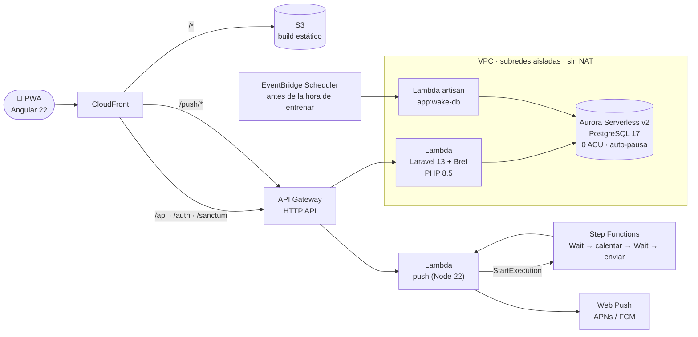

# Gym Tracker

**Español** · [English](README.md)

Planifica rutinas de gimnasio, registra cada serie desde el celular en pleno entreno y mira tu progreso.
Una PWA pensada para el teléfono, hecha para mi propio entrenamiento.

**▶ Prueba la demo:** https://d2vs4ifr98bzf3.cloudfront.net/login → *Probar demo (sin registro)*.
Crea una cuenta temporal con una rutina de ejemplo y seis semanas de historial, que se borra a las dos
horas. La primera carga puede tardar ~15 s mientras despierta la base de datos (es el escalado a cero
funcionando).

## Funciones

- **Rutinas** por día de la semana, con orden por arrastre, series/reps objetivo, descansos y tipos de
  serie (normal, pesada, calentamiento, Bilbo, al fallo, dropset). Se importan desde 7 plantillas
  clásicas (Arnold, Reg Park 5×5, PHUL, PPL de Nippard…).
- **Registro del entreno** pensado para una mano: steppers de peso y reps, sugerencias según la última
  sesión, calentamientos de un toque que no cuentan como series efectivas y buscador de ejercicios.
- **Temporizador de descanso con Web Push**: el aviso llega segundos después de terminar el descanso,
  aun con el teléfono bloqueado (incluida la PWA en iOS).
- **Offline primero**: las series se guardan localmente (IndexedDB) y se sincronizan con ULID generados
  en el cliente, de forma idempotente.
- **Estadísticas**: 1RM estimado, volumen semanal por grupo muscular, rachas de constancia y tendencia
  del peso corporal (ECharts).
- **Invitaciones**: links de un solo uso para que amigos creen su cuenta; más el modo demo para invitados.

## Arquitectura

Todo serverless y de pago por uso en AWS, definido con CDK (TypeScript). Costo: **~USD 3 al mes**, casi
todo de Aurora mientras está despierta.



### Decisiones clave

| Decisión | Por qué |
|---|---|
| **Aurora Serverless v2 en 0 ACU** con auto-pausa a los 5 min | ~4 entrenos a la semana: pagar solo mientras está despierta deja la base en unos pocos dólares al mes. Un despertador programado la enciende antes de la hora habitual de entrenar, y la app muestra un splash animado mientras reanuda (~15 s). |
| **Lambdas en subredes aisladas, sin NAT Gateway** | Un NAT cuesta ~USD 32 al mes, diez veces la app completa. La app PHP solo necesita Aurora; los secretos llegan desde SSM como parámetros `NoEcho` de CloudFormation, no con llamadas en tiempo de ejecución. |
| **Lambda de push fuera de la VPC** | Necesita internet (servicios de push de Apple y Google) y no usa la base. Las peticiones se autorizan con una firma HMAC de la suscripción que emite Laravel. |
| **`Wait` de Step Functions para el descanso** | EventBridge Scheduler tiene precisión de 60 s (los avisos llegaban hasta un minuto tarde). Una máquina de estados Standard espera al segundo hasta una hora absoluta y calienta la Lambda 3 s antes de enviar. |
| **Laravel apto para Lambda** | Sesiones y caché en la base, nada escrito en disco, autenticación SPA de Sanctum con cookies y CSRF bajo un solo dominio de CloudFront (sin CORS). |
| **ULID generados en el cliente** para entrenos y series | El registro offline se sincroniza de forma idempotente: un reintento nunca duplica una serie. |
| **CI/CD con OIDC de GitHub** | Sin claves de AWS de larga duración. Un push a `main` corre los tests, despliega con `cdk deploy`, despierta Aurora, migra y prueba `/api/health`. |

## Stack

- **Frontend:** Angular 22 (standalone, Signals, zoneless), TypeScript estricto, Tailwind 4,
  spartan/ui, Angular CDK, ngx-echarts, Dexie (IndexedDB), service worker de Angular. Tests: Vitest.
- **Backend:** API REST en Laravel 13, Sanctum (cookies SPA + CSRF), Form Requests, Policies, scopes
  globales por usuario, lógica de estadísticas en servicios. Tests: Pest.
- **Infra:** AWS CDK (TypeScript): CloudFront, S3, API Gateway, Lambda (Bref), Aurora Serverless v2,
  Step Functions, EventBridge Scheduler, SSM. Tests: Vitest + aserciones de CDK.
- **Local:** Docker Compose (PostgreSQL 17 + PHP).

**Tests:** 170 de backend (Pest) · 191 de frontend (Vitest) · 59 de infraestructura (Vitest), todos en CI.

## Correrlo en local

Requisitos: PHP 8.5 + Composer, Node 24 y Docker.

```bash
cp backend/.env.example backend/.env
(cd backend && composer install && php artisan key:generate)
docker compose up -d                       # PostgreSQL en localhost:5433, API en :8000
docker compose exec backend php artisan migrate:fresh --seed
(cd frontend && npm install && npm start)  # http://localhost:4200
```

Entra con `luciano@gymtracker.test` / `password` (valores de `SEED_USER_*`) o con el botón de demo.

```bash
(cd backend && ./vendor/bin/pest)
(cd frontend && npx ng test --watch=false)
(cd infra && npm test)                      # sintetiza sin credenciales de AWS
```

## Despliegue

- Push a `main` → workflow `Deploy` (tests, `cdk deploy`, migraciones, health check). No correr
  `cdk deploy GymTrackerStack` desde el PC: subiría dependencias de desarrollo.
- La cuenta de AWS sale de las credenciales del despliegue (rol OIDC); no está guardada en el repo.
- Los secretos viven en SSM Parameter Store bajo `/gymtracker/prod/*` y se crean una sola vez con
  `infra/scripts/init-secrets.sh`.
- Rol OIDC de GitHub (una sola vez): `cd infra && npx cdk deploy GymTrackerCiStack` y guardar el output
  `DeployRoleArn` en el secret de repo `AWS_DEPLOY_ROLE_ARN` (secret, para que quede enmascarado en los
  logs públicos).
- Artisan en producción (requiere `aws login`): `infra/scripts/artisan.sh "migrate:status"`.

## Cómo se construyó

Por fases (base → rutinas → registro → estadísticas → despliegue en AWS → mejoras), cada una con su
spec de diseño y plan de implementación escritos (`docs/superpowers/`), con TDD y un programador IA
como pareja (Claude Code).
