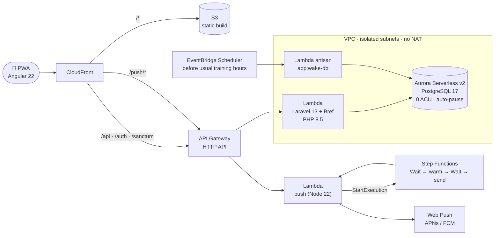

# Gym Tracker

[Español](README.es.md) · **English**

Plan gym routines, log every set from your phone mid-workout and watch your progress. A mobile-first
PWA built for my own training: the UI is in Spanish (Chile).

**▶ Try the live demo:** https://d2vs4ifr98bzf3.cloudfront.net/login → *Probar demo (sin registro)*.
It creates a temporary account with a sample routine and six weeks of history, deleted after two hours.
The first load may take ~15 s while the database wakes up (that's the scale-to-zero at work).

## Features

- **Routines** by weekday, with drag & drop ordering, target sets/reps, rest times and set types
  (normal, heavy, warm-up, Bilbo, to failure, dropset). Import from 7 classic templates
  (Arnold, Reg Park 5×5, PHUL, Nippard PPL…).
- **Workout logging** designed for one hand: weight/reps steppers, suggestions from last session,
  one-tap warm-ups that don't count as working sets, searchable exercise picker.
- **Rest timer with Web Push**: the notification arrives seconds after the rest ends, even with the
  phone locked (iOS PWA included).
- **Offline-first**: sets are stored locally (IndexedDB) and synced with idempotent client-side ULIDs.
- **Stats**: estimated 1RM, weekly volume per muscle group, consistency streaks, bodyweight trend
  (ECharts).
- **Invitations**: single-use links to let friends sign up; plus the guest demo mode.

## Architecture

Fully serverless and pay-per-use on AWS, defined with CDK (TypeScript). Cost: **~USD 3/month**,
almost all of it Aurora compute while awake.



### Key decisions

| Decision | Why |
|---|---|
| **Aurora Serverless v2 at 0 ACU** with 5-min auto-pause | ~4 workouts a week: paying only while awake keeps the database at a few dollars a month. A scheduled warm-up wakes it before the usual training time; the app shows an animated splash while it resumes (~15 s). |
| **Lambdas in isolated subnets, no NAT Gateway** | A NAT costs ~USD 32/month, ten times the whole app. The PHP app only needs Aurora; secrets come in as `NoEcho` CloudFormation parameters from SSM instead of runtime API calls. |
| **Push Lambda outside the VPC** | It needs the internet (Apple/Google push services) and no database. Requests are authorized with an HMAC signature of the subscription issued by Laravel. |
| **Step Functions `Wait` for the rest timer** | EventBridge Scheduler has 60-s precision (notices arrived up to a minute late). A Standard state machine waits to the second until an absolute end time and warms the Lambda 3 s before sending. |
| **Laravel kept Lambda-friendly** | Sessions and cache in the database, nothing written to disk, Sanctum SPA cookie auth with CSRF behind one CloudFront domain (no CORS). |
| **Client-generated ULIDs** for workouts and sets | Offline logging syncs idempotently: retries never duplicate a set. |
| **CI/CD with GitHub OIDC** | No long-lived AWS keys. Pushing to `main` runs the tests, deploys with `cdk deploy`, wakes Aurora, migrates and smoke-tests `/api/health`. |

## Stack

- **Frontend:** Angular 22 (standalone, Signals, zoneless), strict TypeScript, Tailwind 4, spartan/ui,
  Angular CDK, ngx-echarts, Dexie (IndexedDB), Angular service worker. Tests: Vitest.
- **Backend:** Laravel 13 REST API, Sanctum (SPA cookies + CSRF), Form Requests, Policies, global
  per-user scopes, stats logic in services. Tests: Pest.
- **Infra:** AWS CDK (TypeScript): CloudFront, S3, API Gateway, Lambda (Bref), Aurora Serverless v2,
  Step Functions, EventBridge Scheduler, SSM. Tests: Vitest + CDK assertions.
- **Local:** Docker Compose (PostgreSQL 17 + PHP).

**Tests:** 170 backend (Pest) · 191 frontend (Vitest) · 59 infrastructure (Vitest), all run in CI.

## Run it locally

Requirements: PHP 8.5 + Composer, Node 24, Docker.

```bash
cp backend/.env.example backend/.env
(cd backend && composer install && php artisan key:generate)
docker compose up -d                       # PostgreSQL on localhost:5433, API on :8000
docker compose exec backend php artisan migrate:fresh --seed
(cd frontend && npm install && npm start)  # http://localhost:4200
```

Sign in with `luciano@gymtracker.test` / `password` (the `SEED_USER_*` values), or use the demo button.

```bash
(cd backend && ./vendor/bin/pest)
(cd frontend && npx ng test --watch=false)
(cd infra && npm test)                      # synthesizes without AWS credentials
```

## Deployment

- Push to `main` → the `Deploy` workflow (tests, `cdk deploy`, migrations, health check). Don't run
  `cdk deploy GymTrackerStack` from a laptop: it would ship development dependencies.
- The AWS account is taken from the deploy credentials (OIDC role); it isn't stored in the repo.
- Secrets live in SSM Parameter Store under `/gymtracker/prod/*`, created once with
  `infra/scripts/init-secrets.sh`.
- One-time setup of the GitHub OIDC role: `cd infra && npx cdk deploy GymTrackerCiStack`, then store
  its `DeployRoleArn` output in the repository variable `AWS_DEPLOY_ROLE_ARN`.
- Artisan in production (needs `aws login`): `infra/scripts/artisan.sh "migrate:status"`.

## How it was built

Phase by phase (base → routines → logging → stats → AWS deploy → improvements), each with a written
design spec and implementation plan (`docs/superpowers/`), test-driven, with an AI pair programmer
(Claude Code).
